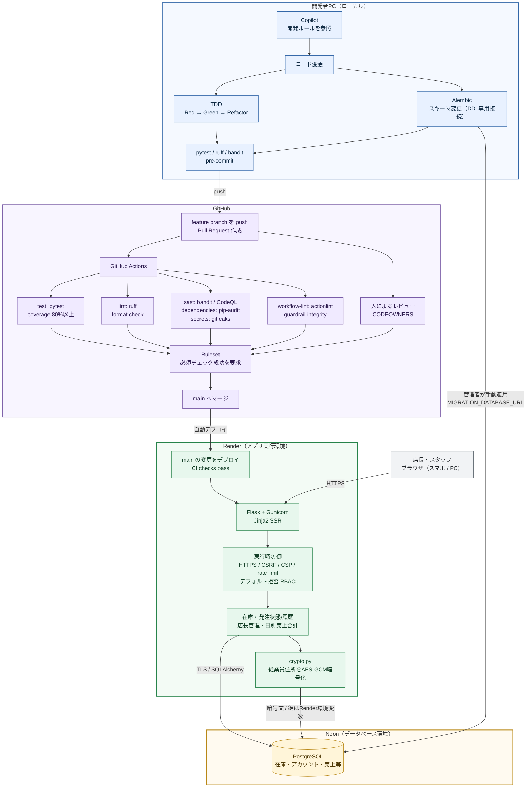

# 構成説明（講義用）

## 1. 一言で
「AIが書いたコードを**信じない**」前提で、**書かせる前（指示）→書いた直後（ローカル）→マージ前（PR/CI）→デプロイ（Render）→動作中（アプリ）→事後（監査）**の6段階で止める。

## 2. 全体アーキテクチャ


色分けは、青＝開発者PC、紫＝GitHub、緑＝Render、黄＝Neon、灰＝利用者です。矢印はコードの流れ、利用者のリクエスト、アプリとDB間の通信を表します。

## 3. ディレクトリ構成
```
.
├─ app/                      アプリ本体（Flask app factory）
│  ├─ __init__.py            create_app: セキュリティヘッダ/CSRF/レート制限 + 【デフォルト拒否の関所】
│  ├─ authz.py               @public / @roles_required（認可の宣言）
│  ├─ crypto.py              住所の列暗号化（AES-256-GCM）
│  ├─ audit.py               監査ログ（個人情報は書かない）
│  ├─ models.py              User / Item / StockLog / PurchaseOrder / Employee / Sale / AuditLog
│  ├─ config.py              環境変数読込（必須値が無いと起動しない）
│  ├─ cli.py                 init-db / create-owner / generate-key
│  ├─ auth/                  ログイン・ロックアウト・Argon2id・パスワード変更
│  ├─ inventory/             朝の在庫確認・在庫更新・発注候補（店長/スタッフ）
│  ├─ admin/                 売上・従業員住所・アカウント・監査ログ（店長のみ）
│  └─ templates/ static/     Jinja2(自動エスケープ) / CSS（インラインJSなし=CSP厳格）
├─ tests/
│  ├─ test_authz_matrix.py   ★全ルートを自動列挙する認可ハーネス
│  ├─ test_auth.py           ログイン/ロック/CSRF/ヘッダ/セッション失効
│  └─ test_features.py       在庫・発注・暗号化・XSS・店長専用機能
├─ .github/
│  ├─ copilot-instructions.md  【L1】AIへの規約
│  ├─ CODEOWNERS               【L3】重要領域は人間承認
│  ├─ pull_request_template.md 【L3】セキュリティチェックリスト
│  ├─ dependabot.yml           依存の自動更新
│  └─ workflows/ci.yml, codeql.yml  【L4】CI
├─ .pre-commit-config.yaml   【L2】コミット前チェック
├─ render.yaml               【L5】デプロイ定義（CI成功後のみ）
├─ alembic.ini / migrations/ DBスキーマの履歴管理（Alembic）
├─ pyproject.toml            ruff / pytest(カバレッジ80%) / bandit 設定
├─ requirements*.txt         本番依存 / 開発依存
├─ wsgi.py                   Gunicorn のエントリ
└─ docs/                     要件定義・多層防御設計・AIルール・本ファイル
```

## 4. 多層防御：どの層が何を止めるか
| 層 | 場所 | 止めるもの（例） |
|---|---|---|
| L1 AI指示 | `.github/copilot-instructions.md` | SQL連結、`\|safe`、認可なしルートを**そもそも書かせない** |
| L2 ローカル | `.pre-commit-config.yaml` | 秘密鍵・APIキーのコミット、危険コード（bandit） |
| L3 PR | CODEOWNERS / PRテンプレ / ブランチ保護 | 認証・暗号・CI設定をAIが勝手に変更してマージ |
| L4 CI | `ci.yml` `codeql.yml` | lint違反、テスト失敗、脆弱な依存、秘密情報、危険コード、認可宣言漏れ |
| L5 デプロイ | `render.yaml` | CI未通過のデプロイ、秘密情報のリポジトリ混入 |
| L6 実行時 | `app/` 全体 | 未認証アクセス、権限逸脱、CSRF、XSS、総当たり、DB漏えい時の住所閲覧 |
| L7 事後 | `audit.py` / 監査ログ画面 | 不正操作の追跡（誰が住所/売上を見たか） |

## 5. 核となる3つの仕組み（講義のハイライト）
1. **デフォルト拒否の関所**（`app/__init__.py` の `enforce_access`）
   全リクエストを「認証→セッション期限→ロール→パスワード変更強制」の順に検査。`@roles_required` を付け忘れたルートは **403**。AIが宣言を忘れても漏れない。
2. **認可ハーネス**（`tests/test_authz_matrix.py`）
   `url_map` から全ルートを自動列挙し、(a)宣言の有無 (b)公開ルートは login/healthz のみ (c)未ログインは全拒否 (d)スタッフは店長専用で403 を検査。**新ルートを足すとテストが自動で対象にする**ので、AI生成コードの認可漏れをCIが検出する。
3. **データ別の防御**
   | データ | 対策 |
   |---|---|
   | ログイン情報 | Argon2id、12文字以上、5回失敗で15分ロック、ユーザー有無を漏らさない、変更時に全セッション失効 |
   | 従業員住所 | AES-GCMで暗号化保存、店長のみ、閲覧を監査ログ記録、一覧には出さない |
   | 売上 | 店長のみ（直URLでもスタッフは403）、閲覧を監査ログ記録 |
   | 在庫 | 認証必須、更新履歴（誰が・前後の値）、入力範囲検証 |

## 6. ロール別の権限
| 機能 | 店長 | スタッフ |
|---|:-:|:-:|
| 在庫確認・在庫数更新・発注候補 | ○ | ○ |
| 品目の追加/編集/削除 | ○ | × |
| 売上、従業員（住所）、アカウント、監査ログ | ○ | × |

## 7. 動かし方
```powershell
python -m venv .venv; .\.venv\Scripts\activate
pip install -r requirements-dev.txt
copy .env.example .env        # SECRET_KEY / ENCRYPTION_KEY / DATABASE_URL / MIGRATION_DATABASE_URL を設定
flask --app wsgi init-db
flask --app wsgi create-owner tencho   # パスワードは対話入力
flask --app wsgi run
pytest ; ruff check . ; bandit -c pyproject.toml -r app
```

新規DBは `init-db`（`alembic upgrade head`）で作成します。従来の `init-db` で作成済みのDBは、Neonのバックアップを確認し、スキーマが `0001_baseline` と一致することを確かめたうえで、初回だけ `python -m dotenv run -- alembic stamp 0001_baseline` を実行し、その後 `flask --app wsgi init-db` で最新化します。マイグレーションにはDDL権限を持つ `MIGRATION_DATABASE_URL` を使い、アプリ実行用の `DATABASE_URL` と分離します。

## 8. 現状の限界と次の一手
- コードで実装済み：L1〜L7 の設定ファイルとアプリ実装、発注状態管理、Alembicスキーマ管理
- **手動設定が必要**（コード化不可）：GitHubのブランチ保護/Rulesets（必須チェック指定）、Secret Scanning/Push Protection、2FA、Render/Neonの作成・環境変数登録、Neonのアプリ用ロール分離 → 手順は [branching.md](./branching.md)
- 保留：退職後1年で住所を削除する方針は合意済みだが、定期削除の実行方法が未決のため自動削除・アカウント連携は未実装
- 未実装（フェーズ2）：店長MFA、ZAP動的検査、型検査(mypy)
